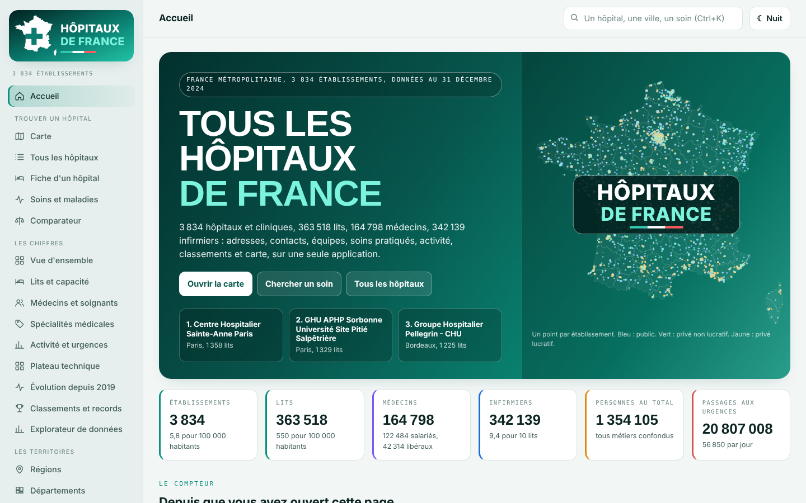
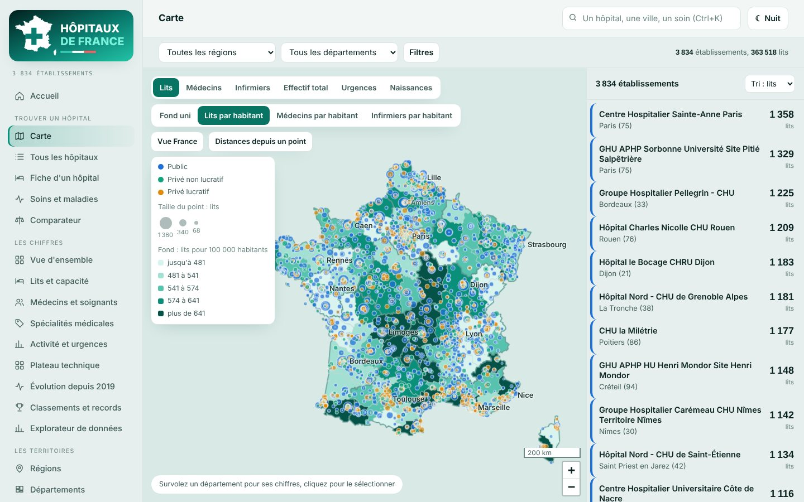
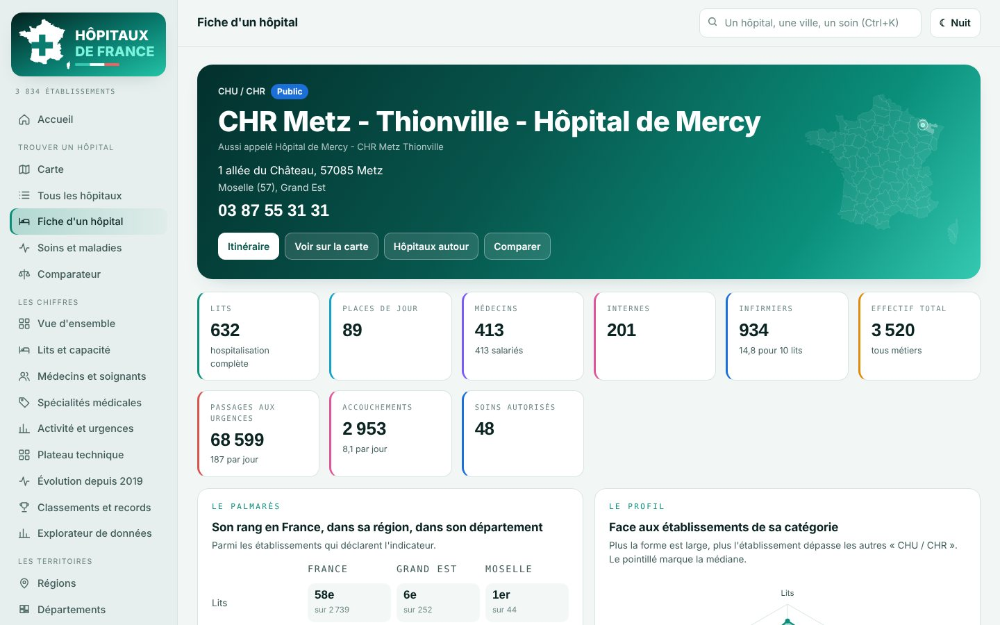
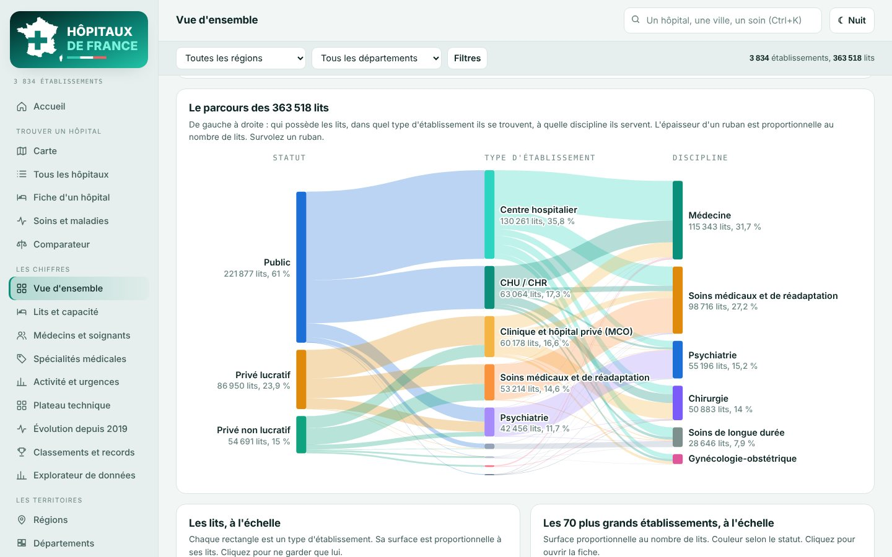
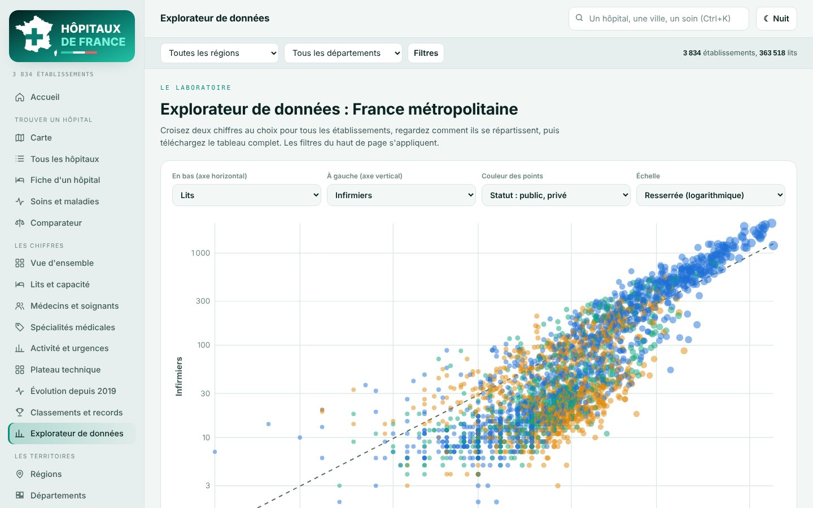
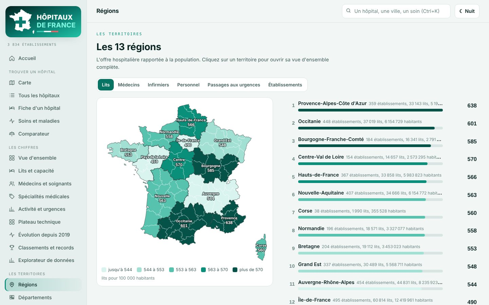
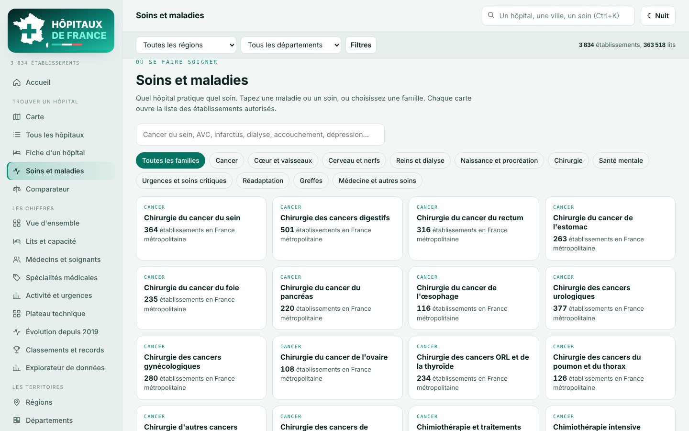
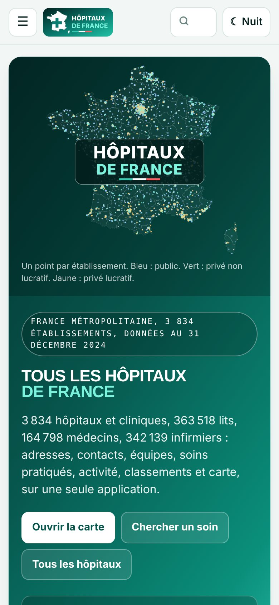
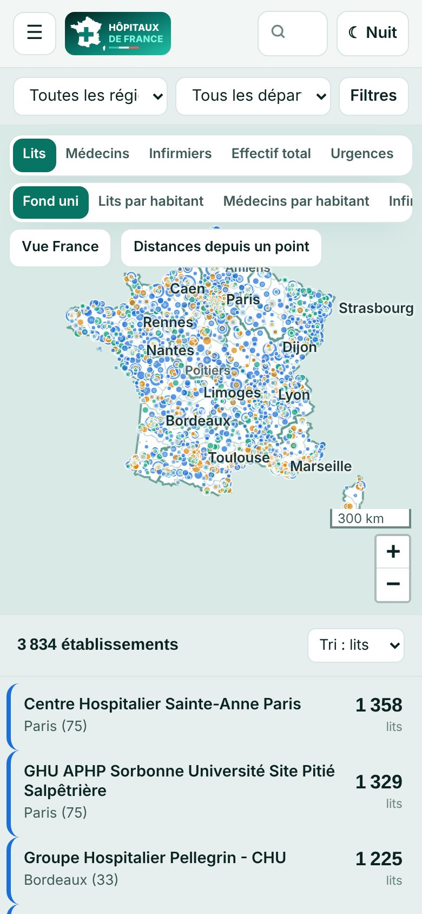

# 🏥 Hôpitaux de France · Tous les hôpitaux et cliniques sur une seule application

**3 834 établissements, 363 518 lits, 164 798 médecins et 342 139 infirmiers : tout l'hôpital de France métropolitaine, établissement par établissement.**
Une application interactive qui réunit l'annuaire complet des hôpitaux et des cliniques, leurs adresses et leurs contacts, leurs lits, leurs équipes, les soins qu'ils pratiquent, leur activité, et toutes les statistiques par région et par département, de 2019 à 2024.

👉 **Ouvrir l'application : https://abdoulhamiddiallo.github.io/hopitaux-de-france/**

---

## 🖥️ Aperçu de l'application

| La carte des hôpitaux | La fiche d'un hôpital |
|---|---|
|  |  |

| Le parcours des lits | L'explorateur de données |
|---|---|
|  |  |

| Les 13 régions | Soins et maladies |
|---|---|
|  |  |

| Format téléphone, accueil | Format téléphone, carte |
|---|---|
|  |  |

---

## 📊 Résultats clés

| Indicateur | Valeur |
|---|---|
| Établissements de santé recensés | **3 834** en France métropolitaine, Corse comprise |
| Lits d'hospitalisation complète | **363 518**, soit un lit pour 182 habitants |
| Places de jour | **88 242** |
| Médecins | **164 798** |
| Infirmiers | **342 139**, soit 2,1 infirmiers pour un médecin |
| Effectif total | **1 354 105** personnes |
| Passages aux urgences en 2024 | **20 807 008**, un toutes les 1,5 seconde |
| Accouchements en 2024 | **616 220**, un toutes les 51 secondes |
| Lits depuis 2019 | **−6,6 %** |
| Places de jour depuis 2019 | **+15,7 %** |
| Soins autorisés classés | **92 soins** en 11 familles |
| Spécialités médicales | **45** |

---

## 💼 Ce que l'application met en lumière

- **Trouver un hôpital en quelques secondes** : par nom, par ville, par soin ou par maladie, sur la carte ou dans l'annuaire, avec l'adresse, le téléphone et l'itinéraire.
- **Savoir qui soigne quoi** : pour chaque soin (cancer du sein, AVC, dialyse, maternité, urgences, greffe), la liste et la carte des établissements autorisés.
- **Mesurer les écarts entre territoires** : lits, médecins, infirmiers et urgences rapportés à la population, région par région et département par département. L'écart de lits par habitant va de 1 à 2,9 entre deux départements.
- **Voir la concentration de l'offre** : 192 sites de CHU, soit 5 % des établissements, réunissent 17,3 % des lits.
- **Suivre le virage ambulatoire** : les lits reculent et les places de jour progressent depuis 2019, courbes à l'appui.

---

## 🧭 Synthèse

L'application est organisée en 21 rubriques regroupées en six parties :

**Trouver un hôpital**
- **Carte** : tous les établissements sur la carte de France, taille des points selon les lits, les médecins, les infirmiers ou les urgences, fond coloré par habitant, distances depuis un point.
- **Tous les hôpitaux** : l'annuaire triable et filtrable.
- **Fiche d'un hôpital** : identité, contacts, capacité, équipes, spécialités, soins pratiqués, activité, plateau technique, évolution, rang national et hôpitaux voisins.
- **Soins et maladies** : 92 soins, chacun avec ses établissements et sa couverture du territoire.
- **Comparateur** : jusqu'à quatre hôpitaux, régions ou départements côte à côte.

**Les chiffres**
- **Vue d'ensemble**, **Lits et capacité**, **Médecins et soignants**, **Spécialités médicales**, **Activité et urgences**, **Plateau technique**, **Évolution depuis 2019**, **Classements et records**.
- **Explorateur de données** : deux chiffres au choix parmi 21, croisés pour tous les établissements, avec la tendance, les répartitions et le téléchargement du tableau en CSV.

**Les territoires**
- **Régions** et **Départements** : cartes interactives, classements et tableau complet pour 100 000 habitants.

**Comprendre**
- **Types d'établissements** et **Lexique** des sigles de l'hôpital.

**Jouer**
- **Quiz** de douze questions.

**Sources et méthode**

---

## 🔄 Chaîne de traitement des données

1. **Collecte** : Statistique annuelle des établissements de santé (SAE) de la DREES pour les années 2019 à 2024, répertoire FINESS, populations de l'Insee, contours de l'IGN.
2. **Rapprochement** : chaque établissement de la SAE est relié à sa fiche FINESS pour retrouver son nom complet, son adresse, son téléphone, sa position et son groupement hospitalier.
3. **Classement des soins** : les activités de soins autorisées et mises en œuvre sont regroupées en 92 soins et 11 familles, avec des mots-clés de maladies pour la recherche.
4. **Calculs** : densités pour 100 000 habitants, taux d'occupation, durée moyenne de séjour, évolutions en base 100, rangs nationaux, concentration de l'offre.
5. **Restitution** : cartes, graphiques, classements, comparateur, explorateur et quiz.

---

## 🧬 Traçabilité des chiffres

| Donnée affichée | Calcul | Source |
|---|---|---|
| Lits, places, équipes, activité, équipements | déclarations des établissements au 31 décembre 2024 | SAE 2024, DREES |
| Soins pratiqués par établissement | autorisations actives et mises en œuvre | FINESS |
| Nom, adresse, téléphone, position | fiche de l'établissement | FINESS |
| Évolution 2019 à 2024 | bases de chaque année | SAE, DREES |
| Densités par habitant | valeur ÷ population × 100 000 | Insee |
| Taux d'occupation | journées ÷ (lits × 366) | Calcul de l'application |
| Contours des régions et des départements | fonds simplifiés | IGN |

---

## 🏗️ Architecture

- **Une seule page HTML autonome** : données, styles, scripts, cartes et graphiques réunis dans `index.html`, sans serveur ni base de données.
- **Navigation par rubriques** avec barre latérale, recherche générale (Ctrl+K), filtres par région, département, type, statut et soin, valables sur toutes les pages.
- **Cartes dessinées à partir des contours officiels**, sans fond de carte externe.
- **Graphiques en SVG dessinés à la main** : schéma à rubans, mosaïques proportionnelles, tableaux de chaleur, courbes de concentration, radars, nuage de points, boîtes de répartition, cartes en cinq classes.
- **Thème jour et nuit**, mémorisé dans le navigateur.
- **Format téléphone soigné** : menu escamotable, carte et commandes adaptées, graphiques redessinés pour l'écran étroit.

---

## 🛠️ Technologies

- HTML5, CSS3 (grilles, variables de thème, `color-mix`), JavaScript
- Leaflet pour la carte principale, SVG pour tous les graphiques
- Polices Google : Inter, Sora, JetBrains Mono
- GitHub Pages pour la mise en ligne

---

## ✅ Conclusion

L'hôpital français, ce sont 3 834 établissements très différents : 192 sites de CHU qui concentrent une grande part des lits et des médecins, des centaines de centres hospitaliers de proximité, des cliniques, des centres de réadaptation, de psychiatrie et de dialyse. L'application les met tous sur la même carte et dans les mêmes tableaux, pour que chacun puisse trouver un établissement, comparer des territoires et lire les grandes évolutions depuis 2019.

---

## 💡 Le mot de la fin

Construire pour explorer. Explorer pour comprendre. Et apprendre en chemin.

**Abdoul Hamid Diallo** · Microsoft Fabric Data Engineer
[LinkedIn](https://www.linkedin.com/in/abdoul-hamid-diallo-fabric-data-engineer/) · [Toutes mes applications](https://abdoulhamiddiallo.github.io/)
